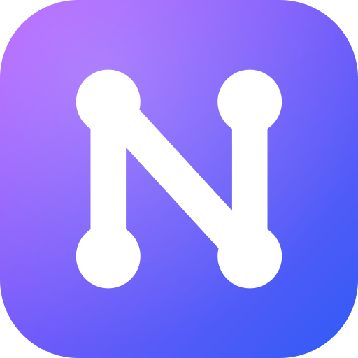

<div align="center">



# NexusAI

**Une interface de jeu de rôle locale, pensée pour les longues histoires à plusieurs
personnages.**

Cartes de personnages, conversations à branches, une mémoire qui tient sur des milliers de
messages, et une couche « canon » qui garde les personnages d'une œuvre fidèles à eux-mêmes.
Tout reste dans ton navigateur.

[](https://github.com/NoahCherel/NexusAI/actions/workflows/ci.yml)
[](LICENSE)


[English](README.md) · **Français**

</div>

---

## Pourquoi NexusAI

La plupart des interfaces de jeu de rôle sont faites pour une courte discussion avec un seul
personnage. NexusAI vise l'inverse : des centaines de messages, toute une troupe en scène, et
des cartes qui décrivent un univers entier (un « Naruto RPG », un « Bleach RPG ») où chaque PNJ
est un personnage canonique de l'œuvre.

- **Elle se souvient.** Les anciens messages sont condensés dans une Chronique hiérarchique au
  lieu d'être oubliés quand ils sortent de la fenêtre de contexte.
- **Elle reste fidèle au canon.** Les faits canoniques sur les personnages vivent dans une
  couche séparée, en lecture seule ; ce qui se passe dans _ton_ histoire est noté par-dessus et
  ne l'écrase jamais.
- **Elle t'appartient.** Pas de compte, pas de base de données côté serveur : ta bibliothèque
  vit dans ton navigateur, et tes clés API sont chiffrées sur ton appareil.

## Fonctionnalités

### Personnages

- Importe des fichiers **Character Card V2** (PNG ou JSON), ou colle un lien **Chub.ai /
  CharacterHub, JannyAI, Pygmalion, RisuAI Realm ou AICharacterCards**.
- Parcours le **catalogue Chub** depuis l'app : recherche, tri, filtres par tags, aperçu complet
  avant import.
- Range tes personnages dans des dossiers ; modifie la carte, y compris ses exemples de dialogue
  et son prompt système.

### Conversations

- **Branches** : régénère, passe d'une variante à l'autre, et navigue dans tout l'arbre des
  messages.
- Modifie, continue, réessaie, ou laisse l'IA écrire un brouillon à la place de ta persona.
- Des **personas** attachées à chaque message : changer de persona ne réécrit jamais
  l'historique.
- **Aperçu du contexte** : vois exactement ce qui sera envoyé au modèle, zone par zone, avec le
  nombre de jetons.

### Scènes à plusieurs personnages

- **Mode Troupe** : un réalisateur IA choisit qui parle et donne une direction à chaque
  personnage. La scène s'affiche en une bulle par personnage, ou en un seul passage unifié.
- **Mode dirigé** _(expérimental)_ : un état de l'histoire, une planification des temps forts et
  un contrôle de cohérence pour les longues scènes d'ensemble.

### Mémoire et continuité

- **Chronique** : des résumés faits en arrière-plan, regroupés en fragments, sections et arcs,
  chacun lié aux messages qu'il couvre et modifiable à la main.
- **Lorebooks** avec une recherche hybride : mots-clés et recherche sémantique, grâce à un modèle
  d'embeddings multilingue
  ([multilingual-e5-small](https://huggingface.co/intfloat/multilingual-e5-small)) qui tourne
  **dans le navigateur**.
- **Canon Codex** : pour les cartes « œuvre entière », des fiches canoniques des personnages
  récupérées sur le web et arrêtées au moment de l'histoire, un casting, et une boussole d'arc
  qui suit où en est le récit.
- **Relations** : des liens orientés (A→B n'est pas B→A) sur quatre axes — confiance, affection,
  respect, attirance — mis à jour après chaque scène, par petites étapes justifiées.
- **Anti-enlisement** : repère les scènes qui tournent en rond et relance le tour suivant.
- Un bloc-notes de travail et des notes par conversation.

### Modèles et coûts

- **OpenRouter**, **NanoGPT** (modèles de l'abonnement et quota en direct) et **OpenAI**.
- Avec OpenRouter : modèles **Batch** (`:batch`, moitié prix), palier flex, coût réel par message
  et **budget hebdomadaire** optionnel.
- **Cache de prompt** : le prompt est découpé en un début stable, une fenêtre d'historique et un
  bloc dynamique, pour que les fournisseurs réutilisent le début en cache d'un tour à l'autre.
- Presets d'échantillonnage, avec import de presets JSON au format SillyTavern et prise en charge
  du prefill.

### Tes données

- Stockées dans **IndexedDB** et **localStorage** ; les clés API sont chiffrées en AES-GCM avec
  une clé non exportable qui ne quitte jamais l'appareil.
- **Sauvegarde globale** dans un seul fichier compressé `.json.gz`, lue par petits paquets pour
  fonctionner même avec des dizaines de milliers de messages. Enregistrée via le menu Partager
  du système (Fichiers, iCloud Drive…).
- La **restauration** vérifie tout le fichier avant d'écrire quoi que ce soit, puis n'ajoute que
  ce qui manque : elle ne supprime et n'écrase jamais rien.
- Installable en **PWA** sur iPhone et Android.

## Comment ça marche

```
 Navigateur (ton appareil)                Routes serveur Next.js            Fournisseurs
┌──────────────────────────────┐        ┌───────────────────────┐        ┌────────────┐
│ Interface React · stores      │ ─────▶ │ /api/chat (streaming) │ ─────▶ │ OpenRouter │
│ IndexedDB : cartes, chats,    │        │ /api/batch            │        │ NanoGPT    │
│   mémoire, canon, scènes      │        │ /api/validate         │        │ OpenAI     │
│ Embeddings locaux (e5)        │        │ /api/import           │ ─────▶ │ sites de   │
│ Clés API chiffrées            │        │ /api/marketplace      │        │ cartes     │
└──────────────────────────────┘        └───────────────────────┘        └────────────┘
```

Le serveur ne garde **rien** : il relaie les requêtes (pour contourner les limites CORS du
navigateur) et c'est tout. Chaque personnage, message et réglage vit dans le navigateur qui l'a
créé.

## Démarrer

**Prérequis :** Node.js 22 (20 et plus fonctionnent) et npm.

```bash
git clone https://github.com/NoahCherel/NexusAI.git
cd NexusAI
npm install
npm run dev
```

Ouvre <http://localhost:3000>, puis :

1. **Réglages → Connexions** : ajoute une clé API OpenRouter, NanoGPT ou OpenAI.
2. Importe une carte de personnage (fichier ou lien), ou parcours le catalogue Chub.
3. Lance une conversation.

Aucune variable d'environnement n'est nécessaire. Pour une version de production :
`npm run build && npm start`.

## Héberger ta propre instance

NexusAI tourne sur tout hébergeur Node qui gère Next.js. Sur **Vercel** : fork le dépôt,
importe-le et déploie, sans aucune configuration.

- Les clés API sont chiffrées dans le navigateur, mais chaque requête passe par les routes
  serveur de ton déploiement avant d'arriver au fournisseur. Héberge ta propre instance plutôt
  que d'utiliser celle de quelqu'un d'autre.
- Certains sites de cartes sont protégés par Cloudflare et peuvent refuser les serveurs cloud ;
  l'importeur retente alors le téléchargement depuis le navigateur.

### Installer sur un téléphone

Ouvre ton instance dans Safari (iOS) ou Chrome (Android) et choisis **Sur l'écran d'accueil**.

> [!IMPORTANT]
> Sur iOS, une app de l'écran d'accueil a son **propre stockage**, séparé de celui de Safari.
> Les données créées dans l'app installée ne sont pas visibles dans un onglet Safari, et
> inversement. Fais tes sauvegardes depuis l'app.

## Sauvegardes

**Réglages → Sauvegardes**

- **Télécharger une sauvegarde globale** écrit conversations, personnages, mémoires et réglages
  dans un seul fichier `.json.gz`. Garde-en une copie en dehors du navigateur.
- **Restaurer un fichier de sauvegarde globale** vérifie le fichier et affiche son contenu avant
  d'écrire quoi que ce soit ; annule à cette étape pour contrôler une sauvegarde sans toucher à
  tes données.
- Les clés API ne font jamais partie d'une sauvegarde : ressaisis-les sur un nouvel appareil.

## Organisation du code

```
src/
├── app/            Pages Next.js (/chat, /rescue) et routes API (/api/*)
├── components/     Interface : chat, personnages, canon, réglages, mise en page, primitives
├── hooks/          Génération, mémoire en arrière-plan, initialisation
├── lib/
│   ├── ai/         Construction du prompt, fournisseurs, mémoire (Chronique, RAG), canon, scènes
│   ├── import/     Détection des liens de sites de cartes et client Chub
│   ├── db.ts       Schéma IndexedDB et accès aux données
│   └── global-backup.ts   Sauvegarde et restauration par flux
├── stores/         Stores zustand (chat, personnages, réglages, lorebooks)
└── types/          Types partagés
Docs/               Notes de conception (mémoire, scènes dirigées, sécurité des données)
```

Le fonctionnement de la mémoire et du contexte est décrit dans
[`Docs/RAG_System_Documentation.md`](Docs/RAG_System_Documentation.md) (en anglais).

## Développement

| Commande               | Rôle                                              |
| ---------------------- | ------------------------------------------------- |
| `npm run dev`          | Serveur de développement                          |
| `npm run build`        | Version de production                             |
| `npm test`             | Tests unitaires (Vitest)                          |
| `npm run lint`         | ESLint                                            |
| `npm run type-check`   | Vérification TypeScript                           |
| `npm run format:check` | Vérification Prettier (`format:write` la corrige) |

Les tests utilisent [fake-indexeddb](https://github.com/dumbmatter/fakeIndexedDB) pour faire
tourner le vrai code de stockage. La CI lance formatage, lint, types, tests et compilation à
chaque push et pull request sur `main`.

## Contribuer

Les issues et pull requests sont les bienvenues.

1. Fork le dépôt et crée une branche depuis `main`.
2. Fais ta modification, avec un test dès qu'elle touche à la logique ou aux données stockées.
3. Lance `npm run format:check && npm run lint && npm run type-check && npm test`.
4. Ouvre une pull request qui explique ce qui change et pourquoi.

Quelques règles de la maison :

- **Les données des utilisateurs d'abord.** Ne jamais lire tout un store IndexedDB d'un coup
  (une bibliothèque peut contenir des dizaines de milliers de messages), ne jamais supprimer un
  store dans une migration, et garder les restaurations additives.
- Les textes de l'interface sont en français.
- Des modifications petites et ciblées ; réutilise les fonctions qui existent déjà.

## Remerciements

- [SillyTavern](https://github.com/SillyTavern/SillyTavern), dont l'écosystème a défini le format
  des cartes de personnages, les conventions de presets et les importeurs de sites de cartes que
  ce projet suit.
- [Transformers.js](https://github.com/xenova/transformers.js) pour les embeddings dans le
  navigateur.
- La [spécification Character Card V2](https://github.com/malfoyslastname/character-card-spec-v2).

## Licence

[MIT](LICENSE) © 2026 Noah Cherel

NexusAI n'est affilié à aucun fournisseur de modèles ni à aucun site de cartes. Tu es
responsable du contenu que tu crées et de ton usage des API tierces.
