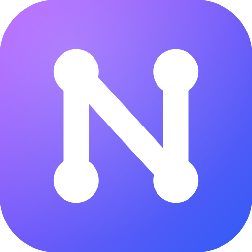

<div align="center">



# NexusAI

**A local-first roleplay front-end for long, multi-character stories.**

Character cards, branching chats, a memory that scales to thousands of messages, and a canon
layer that keeps a franchise's characters true to themselves. Everything stays in your browser.

[](https://github.com/NoahCherel/NexusAI/actions/workflows/ci.yml)
[](LICENSE)


**English** · [Français](README.fr.md)

</div>

---

> [!NOTE]
> The interface is in **French**. The prompts sent to the models work in any language.

## Why NexusAI

Most roleplay front-ends are built for a short chat with one character. NexusAI is built for
the opposite: hundreds of messages, a whole cast on stage, and cards that describe an entire
world (a "Naruto RPG", a "Bleach RPG") where every NPC is a canonical character of the work.

- **It remembers.** Old messages are folded into a hierarchical Chronicle instead of being
  forgotten when they leave the context window.
- **It stays canon.** Canonical facts about characters live in a separate, read-only layer;
  what happens in _your_ story is journaled on top and never overwrites it.
- **It is yours.** No account, no server-side database: your library lives in your browser,
  and API keys are encrypted on your device.

## Features

### Characters

- Import **Character Card V2** files (PNG or JSON), or paste a link from **Chub.ai /
  CharacterHub, JannyAI, Pygmalion, RisuAI Realm or AICharacterCards**.
- Browse the **Chub catalogue** inside the app: search, sort, tag filters, full preview before
  importing.
- Organise characters in folders; edit the card, including its example dialogue and system
  prompt.

### Conversations

- **Branching**: regenerate, swipe between alternatives, and navigate the whole message tree.
- Edit, continue, retry, or let the AI **impersonate** your persona for a draft.
- **Personas** attached to each message, so switching persona never rewrites history.
- **Context preview**: see exactly what will be sent to the model, zone by zone, with token
  counts.

### Multi-character scenes

- **Troupe mode**: an AI director picks who speaks next and gives each character a direction.
  Render the scene as one bubble per character, or as a single unified passage.
- **Directed mode** _(experimental)_: a story state, beat planning and an auditor for longer
  ensemble scenes.

### Memory and continuity

- **Chronicle**: background summaries folded into fragments, sections and arcs, each tied to the
  message range it covers and editable by hand.
- **Lorebooks** with hybrid retrieval: keywords plus semantic search, using a multilingual
  embedding model ([multilingual-e5-small](https://huggingface.co/intfloat/multilingual-e5-small))
  that runs **in the browser**.
- **Canon Codex**: for whole-work cards, canonical character dossiers fetched from the web and
  capped at the story's point in the timeline, a casting roster, and an arc compass that tracks
  where the story stands.
- **Relationships**: directional bonds (A→B is not B→A) on four axes — trust, affection,
  respect, attraction — updated after each beat with capped, justified changes.
- **Momentum**: detects scenes that go in circles and nudges the next turn forward.
- A scratchpad and per-conversation notes for working memory.

### Models and costs

- **OpenRouter**, **NanoGPT** (subscription models and live quota) and **OpenAI**.
- OpenRouter extras: **Batch API** models (`:batch`, half price), flex tier, real per-message
  cost and an optional **weekly budget**.
- **Prompt caching**: the prompt is split into a stable prefix, a history window and a dynamic
  block, so providers can reuse the cached prefix turn after turn.
- Sampler presets, with import of SillyTavern-style JSON presets and prefill support.

### Your data

- Stored in **IndexedDB** and **localStorage**; API keys are encrypted with AES-GCM using a
  non-extractable key that never leaves the device.
- **Global backup** to a single compressed `.json.gz` file, read page by page so it works on
  libraries of tens of thousands of messages. Saved through the system share sheet (Files,
  iCloud Drive…).
- **Restore** checks the whole file before writing anything, then only adds what is missing —
  it never deletes or overwrites.
- Installable as a **PWA** on iPhone and Android.

## How it works

```
 Browser (your device)                    Next.js server routes             Providers
┌──────────────────────────────┐        ┌───────────────────────┐        ┌────────────┐
│ React UI · zustand stores     │ ─────▶ │ /api/chat (streaming) │ ─────▶ │ OpenRouter │
│ IndexedDB: cards, chats,      │        │ /api/batch            │        │ NanoGPT    │
│   memory, canon, scenes       │        │ /api/validate         │        │ OpenAI     │
│ In-browser embeddings (e5)    │        │ /api/import           │ ─────▶ │ card sites │
│ Encrypted API keys            │        │ /api/marketplace      │        └────────────┘
└──────────────────────────────┘        └───────────────────────┘
```

The server is **stateless**: it relays requests (so they avoid browser CORS limits) and keeps
nothing. Every character, message and setting lives in the browser that created it.

## Getting started

**Requirements:** Node.js 22 (20+ works) and npm.

```bash
git clone https://github.com/NoahCherel/NexusAI.git
cd NexusAI
npm install
npm run dev
```

Open <http://localhost:3000>, then:

1. **Réglages → Connexions**: add an OpenRouter, NanoGPT or OpenAI API key.
2. Import a character card (file or link), or browse the Chub catalogue.
3. Start a conversation.

No environment variables are needed. For a production build: `npm run build && npm start`.

## Deploy your own

NexusAI runs on any Node host that supports Next.js. On **Vercel**: fork the repository, import
it, and deploy — no configuration needed.

- API keys are stored encrypted in the browser, but each request passes through your
  deployment's server routes on its way to the provider. Host your own instance rather than
  using someone else's.
- Some card sites sit behind Cloudflare and may refuse requests from cloud servers; the importer
  then retries the download from the browser.

### Install on a phone

Open your instance in Safari (iOS) or Chrome (Android) and choose **Add to Home Screen**.

> [!IMPORTANT]
> On iOS, a home-screen app has its **own storage**, separate from Safari's. Data created in the
> installed app is not visible in a Safari tab, and vice versa. Back up from inside the app.

## Backups

**Réglages → Sauvegardes**

- **Télécharger une sauvegarde globale** writes conversations, characters, memories and settings
  into one `.json.gz` file. Keep a copy outside the browser.
- **Restaurer un fichier de sauvegarde globale** verifies the file and shows what it contains
  before writing anything; cancel at that step to check a backup without touching your data.
- API keys are never part of a backup: enter them again on a new device.

## Project structure

```
src/
├── app/            Next.js pages (/chat, /rescue) and API routes (/api/*)
├── components/     UI: chat, characters, canon, settings, layout, ui primitives
├── hooks/          Generation flow, background memory pipeline, app init
├── lib/
│   ├── ai/         Prompt building, providers, memory (Chronicle, RAG), canon, scenes
│   ├── import/     Card-site URL detection and Chub client
│   ├── db.ts       IndexedDB schema and data access
│   └── global-backup.ts   Streamed backup and restore
├── stores/         zustand stores (chat, characters, settings, lorebooks)
└── types/          Shared types
Docs/               Design notes (memory system, directed scenes, data safety)
```

The memory and context pipeline is documented in
[`Docs/RAG_System_Documentation.md`](Docs/RAG_System_Documentation.md).

## Development

| Command                | What it does                          |
| ---------------------- | ------------------------------------- |
| `npm run dev`          | Development server                    |
| `npm run build`        | Production build                      |
| `npm test`             | Unit tests (Vitest)                   |
| `npm run lint`         | ESLint                                |
| `npm run type-check`   | TypeScript, no emit                   |
| `npm run format:check` | Prettier check (`format:write` fixes) |

Tests use [fake-indexeddb](https://github.com/dumbmatter/fakeIndexedDB) to exercise the real
storage code. CI runs format, lint, type-check, tests and build on every push and pull request
to `main`.

## Contributing

Issues and pull requests are welcome.

1. Fork the repository and create a branch from `main`.
2. Make your change, with a test when it touches logic or stored data.
3. Run `npm run format:check && npm run lint && npm run type-check && npm test`.
4. Open a pull request describing what changed and why.

A few house rules:

- **User data comes first.** Never read a whole IndexedDB store at once (libraries can hold tens
  of thousands of messages), never drop a store in a migration, and keep restores additive.
- UI text is written in French.
- Keep changes small and focused; prefer the helpers that already exist.

## Acknowledgements

- [SillyTavern](https://github.com/SillyTavern/SillyTavern), whose ecosystem defined the
  character-card format, the preset conventions and the card-site importers this project follows.
- [Transformers.js](https://github.com/xenova/transformers.js) for running embeddings in the
  browser.
- The [Character Card V2 specification](https://github.com/malfoyslastname/character-card-spec-v2).

## License

[MIT](LICENSE) © 2026 Noah Cherel

NexusAI is not affiliated with any model provider or character-card site. You are responsible
for the content you create and for your use of third-party APIs.
